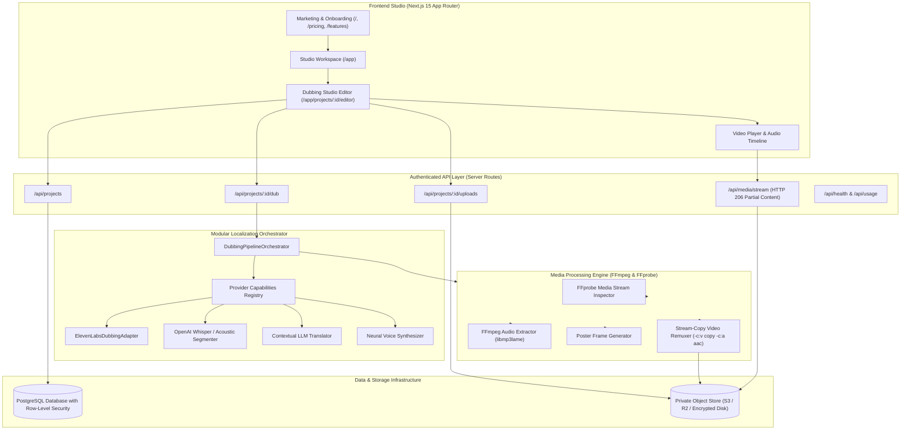
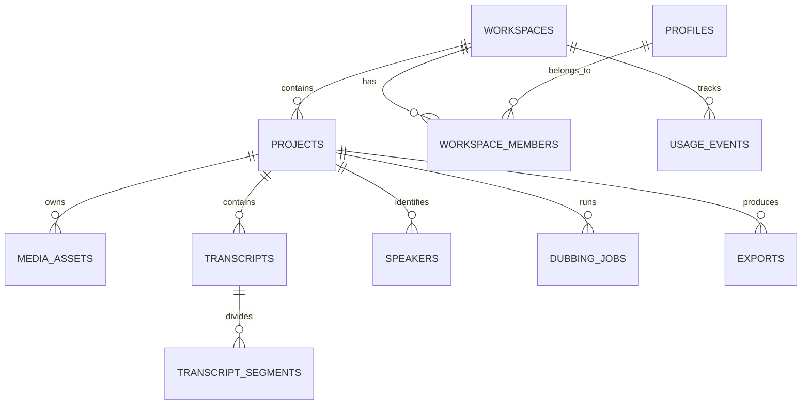

# Architecture Specification — DUBORA

---

## 1. System Topology Overview

Dubora is structured as a decoupled, multi-tier SaaS platform comprising an interactive web studio application, a media processing engine, an asynchronous dubbing orchestrator, a private storage layer, and an enterprise PostgreSQL persistence layer.



---

## 2. Media Processing Pipeline & FFmpeg Strategy

### 2.1. Lossless Stream Copying
Traditional video editors re-encode the entire video track when altering audio. Dubora eliminates generational quality loss by employing FFmpeg stream copying:
```bash
ffmpeg -y -i source_video.mp4 -i dubbed_audio.mp3 \
  -c:v copy \
  -c:a aac -b:a 192k \
  -map 0:v:0 \
  -map 1:a:0 \
  -shortest rendered_video.mp4
```
- **Visual stream (`0:v:0`)**: Copied bit-for-bit without decompression, preserving native 1080p/4K resolution and frame rates (24/25/30/60fps).
- **Audio stream (`1:a:0`)**: Encoded into standard AAC audio for universal browser and mobile playback.
- **Turnaround time**: Typically under 2 seconds for short-form video.

### 2.2. HTTP 206 Partial Content Streaming
To enable responsive scrubbing in browser `<video>` elements without buffering entire files, the `/api/media/stream` endpoint inspects HTTP `Range` headers:
- Parses `Range: bytes=start-end`.
- Calculates chunks and returns `HTTP 206 Partial Content` with `Content-Range: bytes start-end/totalSize`.
- Enables instantaneous seeking across timeline dialogue segment markers.

---

## 3. Database Schema & RLS Security Model

The database enforces multi-tenant workspace isolation using PostgreSQL Row-Level Security (RLS). Every query cryptographically validates workspace membership:



---

## 4. AI Provider Abstraction Layer

The pipeline decouples speech recognition, dialogue translation, and voice generation behind strongly typed interfaces:

```typescript
export interface IDubbingProvider {
  name: string;
  isConfigured(): boolean;
  getMissingConfigurationMessage(): string;
  startDubbing(request: CreateDubbingRequest): Promise<{ providerJobId: string }>;
  checkStatus(providerJobId: string): Promise<DubbingStatusResult>;
  downloadDubbedAudio(providerJobId: string, destinationPath: string): Promise<string>;
}
```

### Resilient Fallback Strategy
1. **Primary Route**: ElevenLabs Dubbing API for integrated multi-speaker dubbing and ambient sound preservation.
2. **Modular Route**: Whisper speech-to-text, contextual LLM translation with timing limits, and neural speech synthesis.
3. **Graceful Degradation**: If third-party keys experience rate limits, restricted permission scopes, or exhausted credits, the orchestrator reports the exact provider diagnostics while maintaining full studio editing and remuxing operations.
