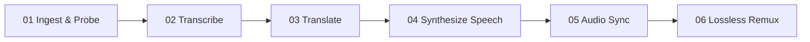
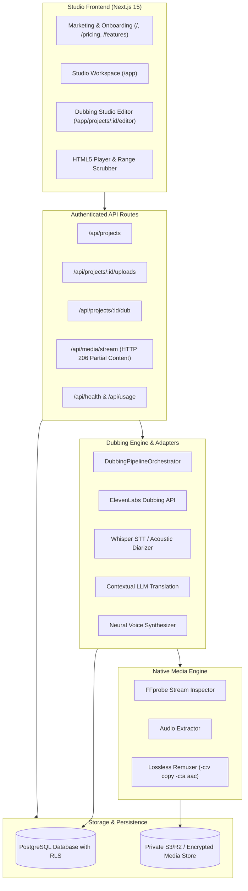

<div align="center">

# 🎙️ DUBORA
### Production-Grade AI Multilingual Video Dubbing SaaS Platform

[](https://nextjs.org/)
[](https://www.typescriptlang.org/)
[](https://tailwindcss.com/)
[](https://ffmpeg.org/)
[](https://supabase.com/)
[](https://vitest.dev/)
[](LICENSE)

<p align="center">
  <b>Your voice. Every language. One workflow.</b><br>
  A creative localization studio combining neural speech recognition, context-aware dialogue translation, speaker-consistent voice synthesis, audio synchronization, and broadcast-ready FFmpeg video export.
</p>

[Explore PRD](PRD.md) • [Architecture](ARCHITECTURE.md) • [Engineering Rules](RULES.md) • [API Reference](API.md) • [Contributing](CONTRIBUTING.md)

</div>

---

## 🎨 Creative Studio Visual Palette

Dubora is styled with a bespoke dark cinematic creative studio palette:

| Swatch | Color Code | RGB | Role in Dubora |
|---|---|---|---|
| **HEATHER** | `#624F55` | `rgb(98, 79, 85)` | Dark moody surfaces, borders, panel shadows, and obsidian shell (`#0C0A0C`) |
| **DUSKY PINK** | `#B1968F` | `rgb(177, 150, 143)` | Primary brand accent, primary CTA buttons, timeline segment highlights |
| **FERN** | `#5B7373` | `rgb(91, 115, 115)` | Audio waveforms, synchronization state chips, secondary studio controls |
| **EUCALYPTUS** | `#9BA9AA` | `rgb(155, 169, 170)` | Dialogue time codes, active playhead markers, subtitles, and secondary text |
| **QUARTZ** | `#E9DBD8` | `rgb(233, 219, 216)` | Readable typography, subtle card borders, and metadata chips |
| **FEATHER** | `#F6F2F1` | `rgb(246, 242, 241)` | High-contrast headlines, titles, active tabs, and primary text |

---

## ⚡ The Production Pipeline

Dubora executes a resilient 6-stage background dubbing state machine:



1. **Ingest & Probe**: Upload video (MP4, MOV, WebM). FFprobe inspects duration, codecs, resolution, and extracts poster frames into private storage.
2. **Speech Recognition**: Extracts dialogue track with FFmpeg. Transcribes timed speech segments with word-level timestamps.
3. **Contextual Translation**: Dialogue translated with scene context and syllable pacing constraints to preserve visual mouth cadence.
4. **Voice Synthesis**: Neural speech synthesis preserving speaker timbre and pitch in target languages (Spanish, German, Hindi, Japanese, French, etc.).
5. **Audio Synchronization**: Alignment algorithm calculates segment duration and applies quality-safe time stretching.
6. **Lossless Remuxing**: Stream-copies original video frames (`-c:v copy`) and multiplexes new AAC audio with zero visual degradation.

---

## 🏗️ Technical Architecture



---

## 🚀 Key Features

- **Professional Dubbing Studio Editor (`/app/projects/:id/editor`)**:
  - Custom HTML5 video player with speed controls (`0.75x`, `1.0x`, `1.25x`, `1.5x`, `2.0x`).
  - Interactive multi-track timeline with draggable playhead and dialogue segment markers.
  - Side-by-side original source dialogue vs. editable localized dialogue with real-time persistent database saving.
  - Instant re-dubbing triggers and export downloads.
- **Lossless Stream-Copy Video Remuxing**:
  - Video stream is copied without re-encoding, preserving 1080p/4K resolution and frame rates with zero generational visual loss.
- **HTTP 206 Partial Content Streaming**:
  - Video and audio streams support HTTP `Range` headers for instant timeline scrubbing without buffering entire files.
- **Modular AI Provider Architecture**:
  - Replaceable adapters for ElevenLabs Dubbing API, OpenAI Whisper/GPT-4o/TTS, and native fallback engines.
- **Multi-Tenant Security & Row-Level Security (RLS)**:
  - Private media storage by default. No permanent public links.
  - Zero client-side API key exposure.
- **Accurate Quota Accounting**:
  - Minute-by-minute immutable usage event ledger. Failed jobs do not consume user quotas.

---

## 📂 Project Directory Structure

```
dubora/
├── PRD.md                              # Product Requirements Document
├── ARCHITECTURE.md                     # Complete Architectural Specification
├── RULES.md                            # Non-negotiable Engineering Standards
├── API.md                              # REST API Reference & JSON Schemas
├── CONTRIBUTING.md                     # Contribution Guidelines
├── LICENSE                             # MIT License
├── data/
│   ├── db.json                         # Persistent Database Schema
│   └── screenshots/                    # Studio Verification Captures
├── src/
│   ├── app/
│   │   ├── (public)/                   # Landing, Features, Pricing, Security, Legal
│   │   ├── api/                        # Authenticated REST API Endpoints
│   │   │   ├── exports/                # List and stream exports
│   │   │   ├── health/                 # Live configuration & health check
│   │   │   ├── media/stream/           # HTTP 206 partial content streaming
│   │   │   ├── projects/               # Project CRUD, uploads, dubbing
│   │   │   └── usage/                  # Usage & billing ledger
│   │   ├── app/                        # Authenticated Studio Workspace
│   │   │   ├── exports/                # Export library & downloads
│   │   │   ├── projects/[id]/editor/   # Professional Dubbing Studio Editor
│   │   │   ├── projects/new/           # Guided 2-step creation workflow
│   │   │   └── settings/               # api, billing, profile settings
│   │   └── globals.css                 # Custom design tokens & scrollbars
│   ├── components/                     # VideoPlayer, Timeline, UploadZone, Navigation
│   ├── lib/                            # Storage, Database, FFmpeg, Pipeline Orchestrator
│   └── types/                          # Strict TypeScript Interfaces & Schemas
├── supabase/migrations/                # Production SQL Schema & RLS Migrations
└── tests/                              # Unit, Integration & Browser Test Suites
```

---

## 🛠️ Quickstart & Local Setup

### Prerequisites
- Node.js `v20+` or `v24+`
- npm `10+`

### Installation
```bash
# 1. Clone the repository
git clone https://github.com/your-username/dubora.git
cd dubora

# 2. Install dependencies
npm install

# 3. Configure environment variables
cp .env.example .env.local
```

### Environment Configuration (`.env.local`)
```env
NEXT_PUBLIC_APP_URL="http://localhost:3000"
STORAGE_PROVIDER="local" # "local" | "s3" | "r2"

# Live AI Dubbing Providers (Server-Side Only)
ELEVENLABS_API_KEY=""
OPENAI_API_KEY=""
```

### Run Tests & Build
```bash
# Execute unit and media integration tests
npm test

# Build for production
npm run build

# Start production server
npm start
```
Open **`http://localhost:3000`** in your browser to launch the studio.

---

## 🧪 Testing & Verification

Dubora includes automated unit and integration tests powered by **Vitest** and browser verification via **Playwright**:
```bash
npm test
```
```
Test Files  3 passed (3)
     Tests  6 passed (6)

✓ tests/validation.test.ts (3 tests)
  - should support core 11 target languages with metadata
  - should validate project creation schema correctly
  - should honestly report provider readiness and never fake active status

✓ tests/pipeline.test.ts (2 tests)
  - should create and update project records with state transitions
  - should persist transcript edits persistently without loss

✓ tests/ffmpeg.test.ts (1 test)
  - should successfully probe real media files and return valid duration and codecs
```

---

## 📄 License

This project is licensed under the [MIT License](LICENSE).
